# 系统设计 · 文档优先门禁（开发前置）

本篇规定**系统开发前的文档强制要求**，是全栈工程纪律的"前置闸门"。凡触发"新项目 / 新模块 / 新功能 /  
架构调整 / 技术选型"等开发意图（轻量单文件修复除外），**必须先完成对应项目文档，经评审通过，方可进入编码**。

> 原则：**先写清楚，再写代码。** 文档不是交付负担，而是需求冻结、接口契约、验收口径与团队协作的唯一事实源。

---

## 一、完整软件项目文档清单（强制顺序）

按下列顺序产出，前序文档是后序文档的输入；禁止跳过或倒挂。

| 序号 | 文档                  | 目标读者     | 核心交付物              | 必备图示（mermaid）          |
| -- | ------------------- | -------- | ------------------ | ---------------------- |
| 1  | **需求分析说明书**         | 产品/客户/开发 | 功能需求、非功能需求、用例、验收口径 | 用例图、业务主流程、角色关系、状态机     |
| 2  | **概要设计说明书**         | 架构/开发/测试 | 系统架构、模块划分、技术栈、部署拓扑 | 系统架构图、模块依赖、部署拓扑        |
| 3  | **详细设计说明书**         | 开发       | 类/接口设计、关键算法、契约     | 类图、时序图、状态机、算法流程图       |
| 4  | **数据库设计说明书**        | 开发/DBA   | 表结构、索引、关系、约束       | ER 图                   |
| 5  | **接口设计文档（API）**     | 前后端/测试   | 端点、请求/响应、错误码、鉴权    | 时序图、请求-响应流             |
| 6  | **原型设计（Prototype）** | 产品/UI/客户 | 页面流、线框、交互说明        | 页面流程图、线框说明（可附 HTML 原型） |
| 7  | **测试计划与用例**         | 测试/开发    | 策略、用例、准入准出         | 测试流程图、覆盖率饼图            |
| 8  | **部署与运维手册**         | 运维/SRE   | 拓扑、发布、回滚、监控        | 部署拓扑、发布甘特图、分支策略        |

> 轻量档（≤1 文件的小改/纯查询）可豁免，但仍建议以"需求→步骤"一句话映射替代；常规/复杂档**必须**走完整清单。  
> 文档评审通过（至少需求与接口冻结）是 Step 3 执行任务的硬前置门禁。

### 文档命名与编号（强制）

- 文件命名采用**两位零填充序号前缀**：`NN-文档名.md`（`NN` 取上表序号）。
- 标准命名：`01-需求分析说明书.md`、`02-概要设计说明书.md`、`03-详细设计说明书.md`、  
  `04-数据库设计说明书.md`、`05-接口设计文档.md`、`06-原型设计.md`、`07-测试计划与用例.md`、  
  `08-部署与运维手册.md`。
- 文档内部一级标题（`#`）写文档名本身（不含编号前缀），编号仅用于文件排序与检索。

### 章节等级规范（强制）

文档内容必须采用**统一递减标题层级**，最多四级，禁止跳级或平铺：

| 层级       | 标记     | 编号格式            | 示例                  |
| -------- | ------ | --------------- | ------------------- |
| 一级（文档标题） | `#`    | 无               | `# 需求分析说明书`         |
| 二级（章）    | `##`   | `1.` `2.` `3.`  | `## 1. 背景与目标`       |
| 三级（节）    | `###`  | `1.1` `1.2`     | `### 1.1 用户角色`      |
| 四级（小节）   | `####` | `1.1.1` `1.1.2` | `#### 1.1.1 角色权限矩阵` |

- 同级章节连续编号，跨章不连续；下一章从 `2.` 重新开始。
- 禁止出现"大段无标题正文"或"标题层级跳跃"（如 `##` 直接跳 `####`）。
- 本文后续模板均按此层级给出，产出文档时严格对齐。

### 内容确定性要求（禁止模棱两可，强制）

- 文档中的所有设计决策**必须给出确定结论**（选定方案 + 理由），禁止把决策推给读者。
- **禁用表述**：`可选`、`建议采用`、`或`、`视情况而定`、`由团队决定`、`可以考虑`、`酌情`、`一般推荐`、  
  `也可以`、`两者皆可`、`待定`、`TBD`（除非在"待办跟踪"章节明确 owner 与截止时间）。
- 若存在备选方案，须明确写成：**"选定 X；放弃 Y；理由 Z"**，不得保留开放式选择。
- 数值、范围、阈值必须给出具体值（如 `响应时间 ≤ 200ms`、`可用性 ≥ 99.9%`），禁止 `较快`、`较大`、`适量` 等模糊量词。
- 接口字段、状态、错误码必须枚举完整，不得用 `等`、`其他` 省略。

---

## 二、图示铁律：禁用 ASCII，统一 mermaid + 配色

1. **禁止 ASCII 图**：任何流程图、架构图、时序图、ER 图、状态图均不得使用字符画（如 `+--+`、`|--|`、框线拼图）。
2. **一律 mermaid**：需要图的场景必须输出 mermaid 代码块（`mermaid ... `）。
3. **必须配色**：每个 mermaid 块需通过 `classDef` 定义调色板并应用到节点/参与者，保证可读性与层次。  
   **例外**：`classDiagram` 在 mermaid ≤ 8.8.3 不支持 `classDef`/`style` 自定义着色（解析直接报错），类图改用默认样式即可，仍满足「无 ASCII、用 mermaid」要求。
4. **版本合规**：所有 mermaid 语法锁定 **mermaid ≤ 8.8.3**，确保 **pytora 1.0.3** 可正确渲染。见第三节。

### 统一配色规范（复制即用）

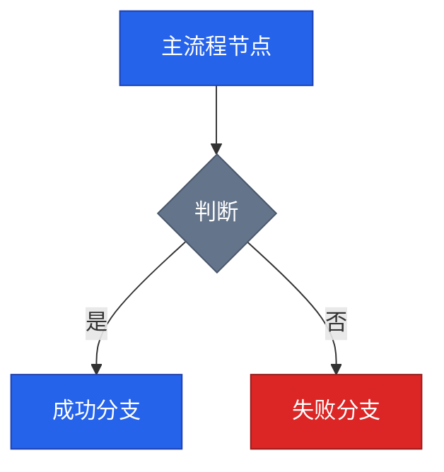

> 配色优先用 `classDef` 显式定义（最兼容 pytora）；如需全局默认，可用 `classDef default fill:...`。  
> 不要依赖自定义 `theme`/`themeVariables` 来上色——旧版渲染器对 theme 变量支持不全。

---

## 三、mermaid 8.8.3 兼容规范（务必遵守）

### 允许使用的图类型（8.8.3 已支持）

- `flowchart`（推荐 `flowchart TD/LR`，勿用旧 `graph` 写法歧义）
- `sequenceDiagram`（含 `autonumber`/`loop`/`alt`/`opt`/`Note`）
- `classDiagram`
- `stateDiagram-v2`（推荐用 `-v2`）
- `erDiagram`（**仅支持实体关系行**，不支持属性块 `{ 字段 }`）
- `gantt`
- `pie`
- `journey`（8.7+，可用但非核心）

### 经 8.8.3 实测不支持的图类型（写文档时禁止使用）

- ❌ `gitGraph` —— 实测 8.8.3 解析即报 `Parse error`（该图类型自 8.9.0 才提供）。
  分支策略图改用 `flowchart LR` 表达，并在图下用 Markdown 表格列出分支规则。
- ❌ `erDiagram` 的实体属性块（`USERS { bigint id PK ... }`）—— 实测 8.8.3 解析报错，
  无论是否缩进、是否带 `PK/FK` 注释、是否带关系行均失败。**字段清单一律用 Markdown 表格承载，
  ER 图只画实体与关系。**

### 禁止使用的特性（9.0 之后才引入，pytora 1.0.3 会渲染失败）

- ❌ C4 系列（`C4Context`/`C4Container`/`C4Component`）—— 9.0+
- ❌ `mindmap` —— 9.2+
- ❌ `timeline` —— 9.3+
- ❌ `quadrantChart` —— 9.4+
- ❌ `architecture` / `block-beta` —— 9.3+
- ❌ `sankey` —— 9.x
- ❌ `xychart-beta` —— 10.x
- ❌ `requirement` 需求图 —— 9.x（需求追踪改用 `flowchart`/`classDiagram` 表达）
- ❌ 多节点合并边 `A & B --> C` —— 9.3+（改为逐条边）
- ❌ 流程图中 `:::note` 等 callout 盒子 —— 9.x
- ❌ 节点文本含未加引号的特殊字符（`()`、`/`、`:`、`#`）—— 一律用双引号包裹

### 兼容性写法要点

- 节点标签含括号/斜杠/冒号时加双引号：`A["处理(异步)"]`。
- 子图用 `subgraph 标题 ... end`，方向用 `direction TB/LR`。
- 时序图参与者用 `participant X as 名称`；**`actor` 不支持 `as` 后缀**（8.8.3 报解析错），
  需角色语义时用 `participant U as 用户`。
- 颜色只用 `classDef` + `class 节点 类名`，不要用 HTML `<style>` 注入。
- 不写 `%%{init: ...}%%` 复杂配置；如需浅色背景，用 `classDef` 控制即可。
- **类图着色限制**：mermaid ≤ 8.8.3 的 `classDiagram` 不支持 `classDef`/`style`/`cssClass` 自定义着色（解析报错），类图直接写类与关系、用默认样式，不要写 `classDef`/`style` 行。

---

## 四、各文档模板与配色示例

### 4.1 需求分析说明书（SRS）

**必备章节**：1. 背景与目标　2. 用户角色与权限　3. 功能需求（用例）　4. 非功能需求（性能/安全/可用）　5. 验收标准　6. 范围与边界　7. 术语表

**用例与业务主流程（flowchart + 配色）**：

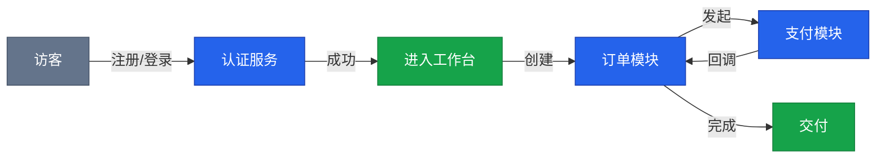

**关键对象状态机（stateDiagram-v2 + 配色）**：

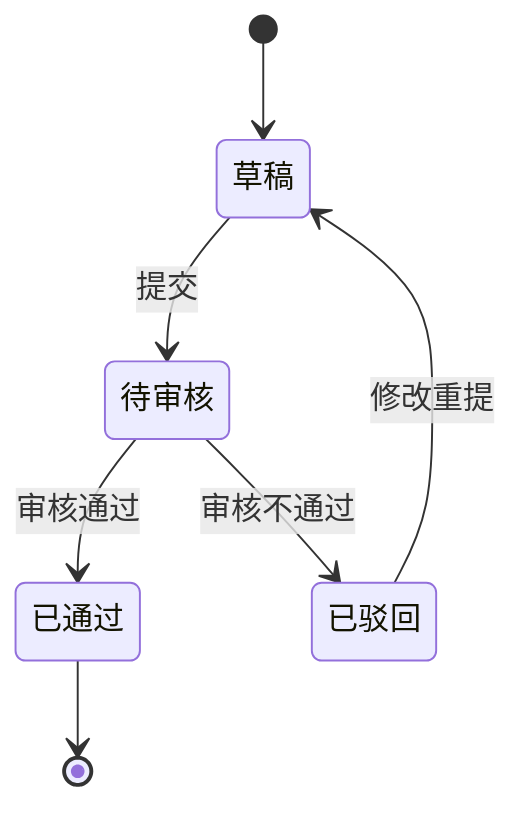

### 4.2 概要设计说明书

**必备章节**：1. 设计目标与约束　2. 系统总体架构　3. 模块划分与职责　4. 技术栈选型与理由　5. 关键中间件　6. 部署与高可用　7. 风险与权衡

**系统架构图（flowchart + 配色）**：

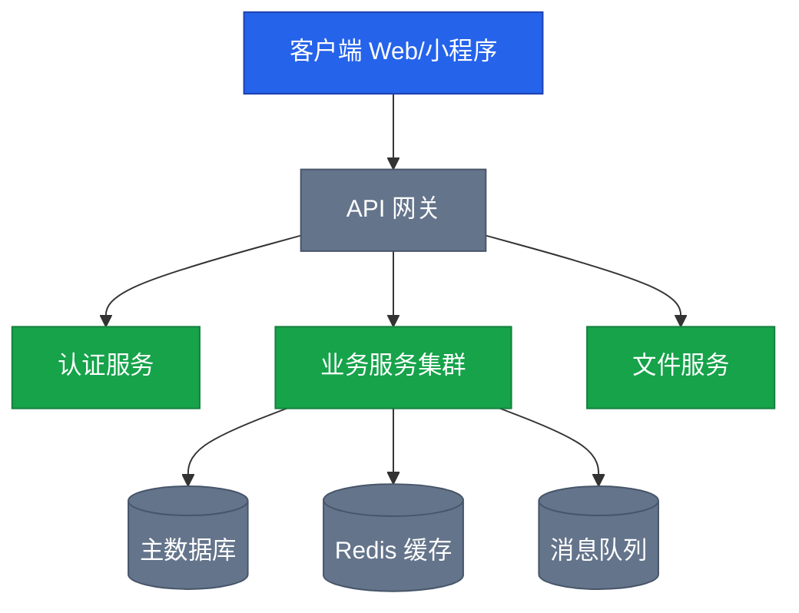

**部署拓扑（flowchart + 配色）**：

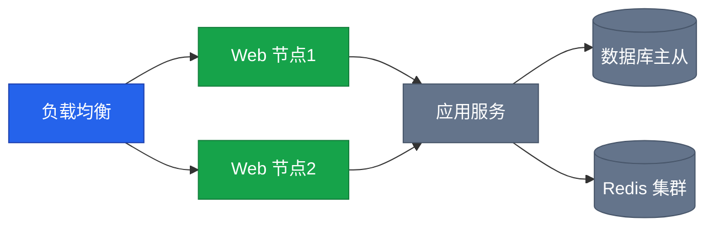

### 4.3 详细设计说明书

**必备章节**：1. 模块内部设计　2. 核心类/接口定义　3. 关键算法与流程　4. 异常与边界　5. 与概要设计的一致性

**领域类图（classDiagram + 配色）**：

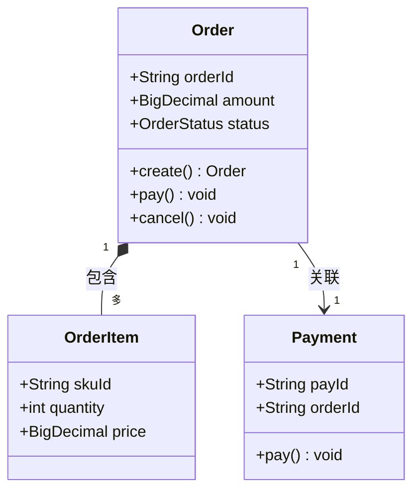

**关键时序（sequenceDiagram + 配色）**：

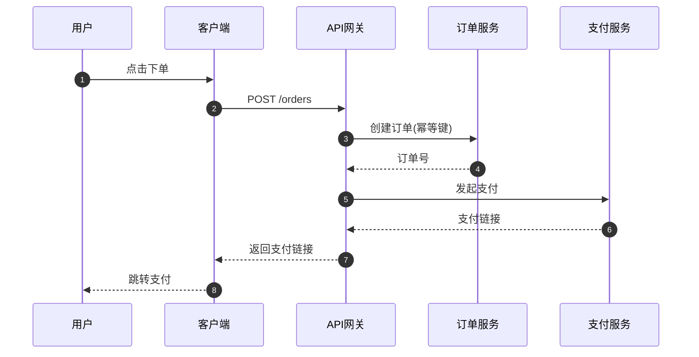

### 4.4 数据库设计说明书

**必备章节**：1. 设计原则（范式/分库分表）　2. 实体关系　3. 表结构（字段/类型/约束/索引）　4. 读写分离与分片　5. 数据迁移与回滚

**ER 图（erDiagram，仅关系；8.8.3 不支持属性块，字段用下方表格承载）**：

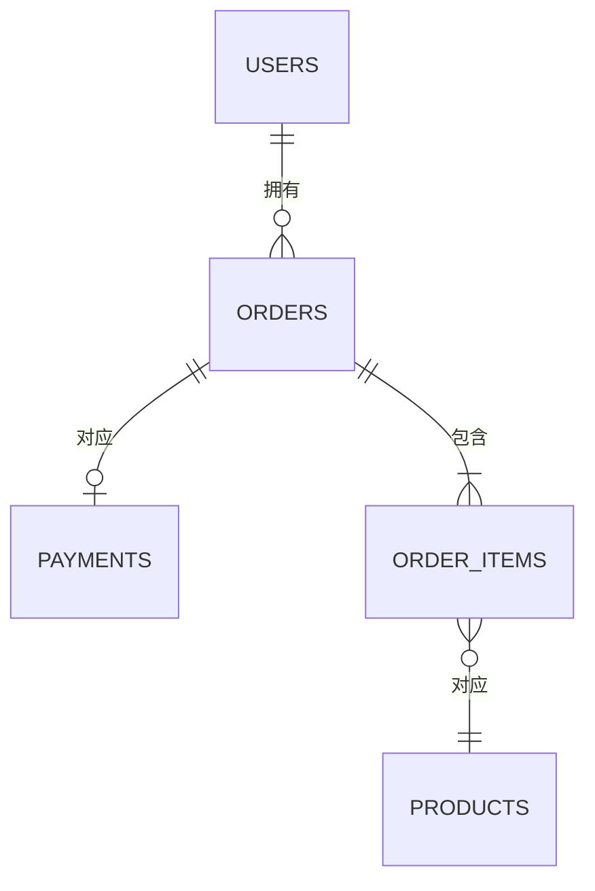

**核心表结构（字段清单以表格为准，图不重复承载字段）**：

| 表 | 字段 | 类型 | 约束 | 说明 |
|----|------|------|------|------|
| users | id | bigint | PK, auto_increment | 用户主键 |
| users | username | varchar(64) | UNIQUE, NOT NULL | 登录名 |
| users | password_hash | varchar(255) | NOT NULL | bcrypt 哈希，禁止存明文 |
| users | created_at | datetime | NOT NULL, default now | 创建时间 |
| orders | id | bigint | PK, auto_increment | 订单主键 |
| orders | user_id | bigint | FK → users.id, NOT NULL | 下单用户 |
| orders | amount | decimal(12,2) | NOT NULL | 订单金额 |
| orders | status | varchar(16) | NOT NULL | 状态机取值见下表 |
| orders | created_at | datetime | NOT NULL, default now | 创建时间 |
| payments | id | bigint | PK, auto_increment | 支付单主键 |
| payments | order_id | bigint | FK → orders.id, NOT NULL | 关联订单 |
| payments | channel | varchar(16) | NOT NULL | 支付渠道：wechat / alipay |
| payments | trade_no | varchar(64) | UNIQUE, NOT NULL | 第三方交易号 |

**订单状态机取值（枚举完整列举）**：

| 状态值 | 含义 | 允许的下一状态 |
|--------|------|----------------|
| CREATED | 已创建待支付 | PAID、CANCELLED |
| PAID | 已支付 | SHIPPED、REFUNDED |
| SHIPPED | 已发货 | COMPLETED |
| COMPLETED | 已完成终态 | 无 |
| CANCELLED | 已取消终态 | 无 |
| REFUNDED | 已退款终态 | 无 |

### 4.5 接口设计文档（API）

**必备章节**：1. 鉴权与通用约定　2. 端点清单　3. 请求/响应示例（含字段类型）　4. 错误码表　5. 限流与幂等　6. 变更与版本

**请求-响应时序（sequenceDiagram + 配色）**：

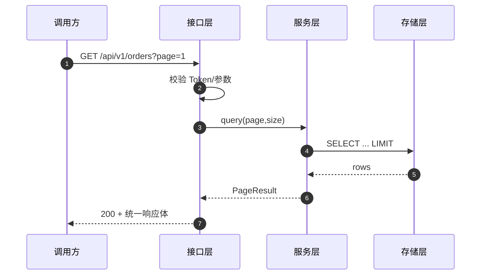

### 4.6 原型设计（Prototype）

**必备章节**：1. 信息架构　2. 页面清单　3. 页面流转　4. 关键页面线框说明　5. 交互与状态（加载/空/错/成功）

**页面流程图（flowchart + 配色）**：

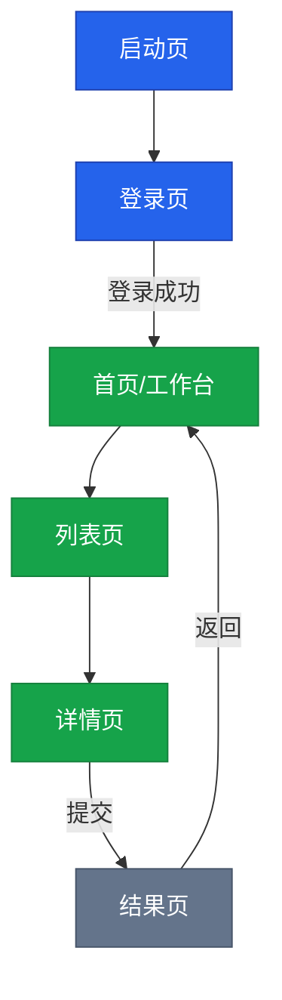

> 高保真原型可另附 **HTML 原型**（用前端设计能力产出可运行页面），但页面流转图仍须用 mermaid。

### 4.7 测试计划与用例

**必备章节**：1. 测试策略（单元/集成/端到端）　2. 测试环境　3. 用例矩阵　4. 准入准出标准　5. 风险与回归

**测试流程与覆盖率（flowchart + pie + 配色）**：


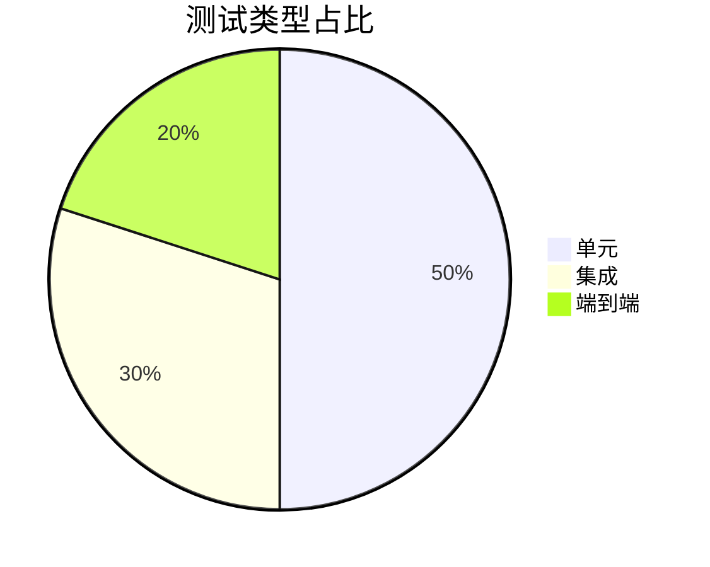

### 4.8 部署与运维手册

**必备章节**：1. 环境清单　2. 部署拓扑　3. 发布流程（灰度/回滚）　4. 监控与告警　5. 应急预案　6. 备份与恢复

**发布甘特（gantt + 配色）**：

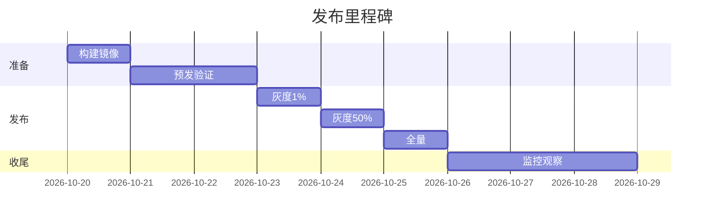

**分支策略（flowchart 表达分支模型；8.8.3 不支持 gitGraph）**：

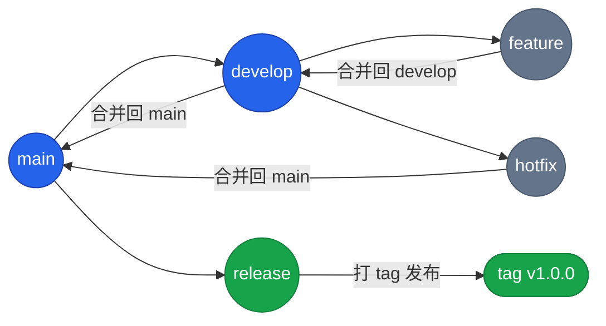

**分支规则（确定表述）**：

| 分支 | 用途 | 来源 | 合并去向 |
|------|------|------|----------|
| main | 生产发布分支，受保护 | develop | 仅接受 release/hotfix 合并 |
| develop | 集成分支 | main | feature/hotfix 合并入此 |
| feature | 功能开发分支 | develop | 合并回 develop |
| hotfix | 线上紧急修复 | main 与 develop | 同时合并回 main 与 develop |
| release | 发版准备分支 | develop | 合并回 main 后打 tag |

---

## 五、文档交付与评审

1. 每篇文档带**版本号与修订记录**（v0.1 草稿 → v1.0 评审通过）。
2. 需求说明书与接口文档为**冻结件**：冻结前可改，冻结后变更须走变更评审。
3. 文档与代码双向一致：接口文档是编码契约，代码实现偏离文档须同步回写文档。
4. 交付物路径建议（带编号前缀）：  
   `docs/01-需求分析说明书.md`、`docs/02-概要设计说明书.md`、`docs/03-详细设计说明书.md`、  
   `docs/04-数据库设计说明书.md`、`docs/05-接口设计文档.md`、`docs/06-原型设计.md`、  
   `docs/07-测试计划与用例.md`、`docs/08-部署与运维手册.md`。

---

## 六、文档自检清单（提交前逐项打勾）

- [ ] 是否按"需求→概要→详细→DB→接口→原型→测试→部署"顺序产出且前序已评审


- [ ] 文件名是否带两位零填充编号前缀（`01-`…`08-`）并与上表序号一致
- [ ] 章节是否遵循等级规范（`#`→`## 1.`→`### 1.1`→`#### 1.1.1`，最多四级、无跳级）
- [ ] 全文**无 ASCII 字符画**（搜索 `+--+`、`|--|`、`+===+` 应为 0）
- [ ] 所有图示均为 `mermaid` 代码块，无字符拼图
- [ ] 每个 mermaid 块均含 `classDef` 配色并应用到节点（`classDiagram` 类图除外，用默认样式）
- [ ] 所有 mermaid 块已通过 mermaid@8.8.3 解析验证（见第七节），解析错误为 0
- [ ] 未使用 9.0+ 特性（C4 / mindmap / timeline / quadrantChart / architecture / sankey / xychart / requirement / `&` 合并边 / callout）
- [ ] 节点标签含特殊字符时已用双引号包裹
- [ ] 语法目标 mermaid ≤ 8.8.3，可在 pytora 1.0.3 渲染
- [ ] **内容无模棱两可**：无 `可选/建议/或/视情况/由团队决定/待定` 等开放式表述；决策均为"选定 X、放弃 Y、理由 Z"
- [ ] 数值/阈值/范围均给出具体值，无 `较快/较大/适量` 等模糊量词
- [ ] 接口字段、状态、错误码已完整枚举，无 `等/其他` 省略
- [ ] 需求与接口文档已冻结，作为编码契约

---

## 七、mermaid 解析验证（强制）

**要求**：写完任意含 mermaid 图的文档后，**必须**用 mermaid@8.8.3 解析器逐块验证，确保可在 pytora 1.0.3 正常显示；任一解析错误（Parse error）须修复后方可交付。

**为什么强制**：mermaid 不同大版本语法差异大（C4 / mindmap / timeline 等为 9.0+ 才引入），且 8.8.3 对部分写法（如 `classDiagram` 的 `classDef`）存在解析缺陷。仅靠肉眼检查极易漏掉这类「能在新版本渲染、在 8.8.3 报错」的问题。

**验证步骤**（本 skill 自带脚本）：

1. 安装一次性依赖（仅验证时需要，不进交付包）：
   ```bash
   cd <skill>/scripts && npm install mermaid@8.8.3 jsdom
   ```
2. 运行校验（自动提取文档内全部 ` ```mermaid ` 块并解析）：
   ```bash
   node validate_mermaid.cjs <你的文档.md>
   ```
3. 判定：输出 `PARSE-ERROR` 的为真实语法错误，必须修复；显示 `WARN (render-env ... getBBox)` 的是 jsdom 渲染环境限制（pytora 实际渲染不受影响），可忽略。
4. 目标：`Summary: N parse-OK, 0 parse-ERROR`。

**常见需修复项（已在本文模板中规避）**：

- 节点标签含 `/`、`(`、`)`、`:`、`#` 等未加双引号 → 用 `"标签"` 包裹。
- 时序图中 `actor X as Y` → 8.8.3 的 `actor` 不支持 `as`，改为 `participant X as Y`。
- `classDiagram` 内出现 `classDef`/`style`/`cssClass` 着色行 → 8.8.3 解析报错，删除这些行改用默认样式。
- 使用 `gitGraph` → 8.8.3 完全不支持（8.9.0 才引入），改用 `flowchart LR` 画分支模型 + 表格列规则。
- `erDiagram` 里写实体属性块 `USERS { bigint id PK }` → 8.8.3 解析报错，改为"ER 图只画关系 + 字段用 Markdown 表格"。
- 误判"新版本能渲染就以为 8.8.3 也能" → 语法能力差异只能靠解析器实测确认，禁止凭印象判断。

**为什么必须跑解析器**：以上 6 类问题中，`gitGraph` 与 `erDiagram` 属性块属于"整块功能缺失"，
而 `classDef`（类图）、`actor as`（时序图）属于"局部语法不支持"，肉眼与记忆都极易漏判；
本 skill 一律以 `validate_mermaid.cjs` 的实测结果为准，不采信任何未经验证的"某版本支持某图"的结论。
